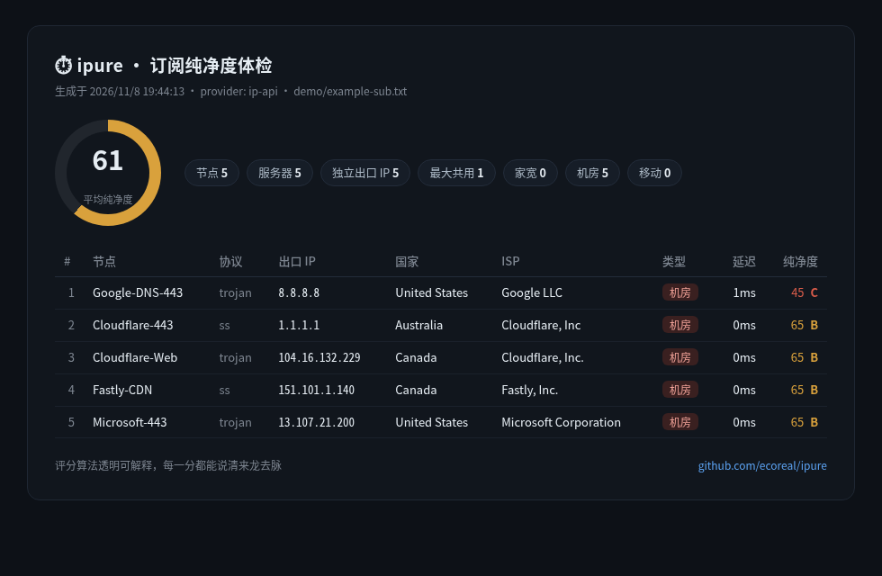

# ⏱ ipure

**Is your airport's IP fresh or burned? Paste a subscription, get the verdict — locally, in seconds.**

[](https://github.com/ecoreal/ipure/actions/workflows/ci.yml)
[](LICENSE)
[](package.json)
[](package.json)

[中文说明](README.zh-CN.md)

```console
$ ipure sub "https://example.com/api/subscribe?token=xxx" --html report.html

⏱  ipure · 订阅纯净度体检
   2026/11/8 19:44:13 · provider: ip-api · 源: demo/example-sub.txt

   节点 5 · 服务器 5 · 独立出口 IP 5
   纯净度 ▇▇▇▇▇▇░░░░ 61/100 · 家宽 0 · 机房 5 · 移动 0
   最干净: Cloudflare-443 (65) · Cloudflare-Web (65) · Fastly-CDN (65)

   #    节点              协议      出口 IP           类型      延迟  纯净度
   ──────────────────────────────────────────────────────────────────────────
   1    Google-DNS-443    trojan         8.8.8.8 机房       1ms   45 C
   2    Cloudflare-443    ss             1.1.1.1 机房       0ms   65 B
   3    Cloudflare-Web    trojan  104.16.132.229 机房       0ms   65 B
   ...
```

IP-quality web tools are great — until an entire forum shares one API quota and
everything rate-limits by noon. **ipure runs the batch check on your machine,
against your own quota.** Paste a subscription link (or a file, or a list of
IPs on stdin) and get:

- **Purity score 0–100** per exit IP — datacenter/proxy/risk penalties, mobile bonus, fully itemised
- **The "burned IP" signal** — how many nodes secretly share one exit IP (the real reason an airport feels "烂大街")
- **TCP latency** per server, median of 3 tries
- **A shareable report card** — standalone HTML, optionally screenshotted to PNG by your local Chromium

No account, no config, zero npm dependencies, one file of Node.



## Install

```bash
npm install -g ipure
# or run once, install nothing:
npx ipure check 8.8.8.8 1.1.1.1
```

Requires Node ≥ 18.17. Nothing else.

## Usage

```bash
# Full subscription health check (URL, local file, or stdin "-")
ipure sub "https://provider.example/subscribe?token=xxx"
ipure sub ./clash-overview.txt --html report.html --png report.png
ipure sub - < nodes.txt --json -

# Check IPs (or hostnames) directly
ipure check 8.8.8.8 1.1.1.1
ipure check 73.0.0.1 223.5.5.5 --json out.json
cat suspicious-ips.txt | ipure check
```

| Option | Meaning |
|---|---|
| `--provider <name>` | `ip-api` (default, no key) · `ipinfo` (set `IPINFO_TOKEN`) |
| `--html <file>` | standalone shareable HTML card |
| `--png <file>` | also screenshot the card via local Chromium (`IPURE_CHROME` to override) |
| `--json <file\|->` | machine-readable output |
| `--sort score` | sort by purity instead of subscription order |
| `--no-latency` | skip TCP ping |
| `--timeout <ms>` / `--conc <n>` | per-op timeout (default 3000) / concurrency (default 8) |
| `--no-color` | plain output |

## The score, itemised

Every point is explainable — no black box, no vibes:

| Signal | Delta | Why |
|---|---|---|
| Base | **100** | innocent until measured |
| Datacenter (hosting) | **−35** | VPS/cloud ranges are cheap and shared |
| Flagged as proxy/VPN/Tor | **−20** | already in a risk database |
| Provider risk score ≥75 / ≥50 / ≥25 | **−25 / −15 / −8** | scaled by severity |
| N nodes share one exit IP | **−3 × (N−1), cap −15** | the "burned IP" tax |
| Mobile carrier exit | **+5** | about as clean as it gets |

Grades: **S** ≥90 native-grade clean · **A** ≥75 · **B** ≥60 usable · **C** ≥40 already flagged · **D** <40 swap it.

## Subscription formats

Whole-body base64 and plain URI lists, one node per line:
`ss://` (SIP002 + legacy) · `vmess://` · `vless://` · `trojan://` ·
`hysteria2://`/`hy2://` · `tuic://` · `ssr://`

Only the **server address** is extracted for measurement — credentials are
parsed and discarded. Clash/Mihomo YAML is on the roadmap.

## Privacy, honestly

- ipure is **local-first**: your subscription token is only ever sent to the provider you pasted it to (plus DNS).
- The default `ip-api` free tier is **plain HTTP** — the list of IPs you check is visible on the wire. For sensitive lists, set `IPINFO_TOKEN` and use `--provider ipinfo` (HTTPS, free 50k/month).
- No telemetry, no "anonymous statistics", zero dependencies to trust.

## Development

```bash
git clone https://github.com/ecoreal/ipure && cd ipure
npm test          # 46 tests, node:test, no network needed
```

## Roadmap

- [ ] Clash/Mihomo YAML subscription parsing
- [ ] `ipure watch` — re-check nightly, diff the scores
- [ ] Blacklist database signal (Spamhaus & friends)
- [ ] Native/broadcast IP detection via RIR data

## License

MIT © 2026 [ecoreal](https://github.com/ecoreal)
