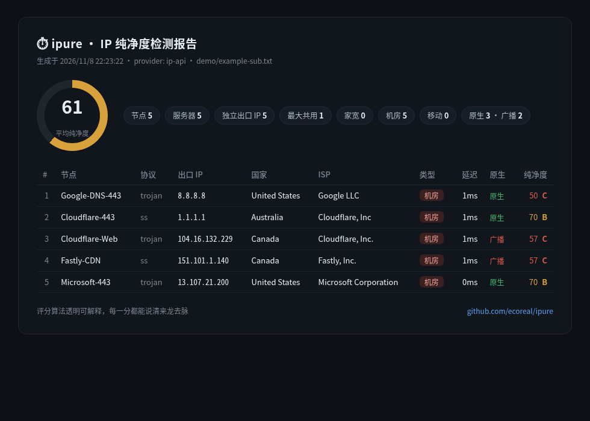

<div align="center">

# ⏱ ipure

**你的 IP 纯净度到底怎么样？贴进来，几秒钟本地出结论。**

[](https://github.com/ecoreal/ipure/actions/workflows/ci.yml)
[](LICENSE)
[](package.json)
[](package.json)
[](#开发)

[English](README.md) · [在线示例报告](https://ecoreal.github.io/ipure/demo-report.html)

**纯净度评分 · 出口验证 · 重复出口 · 原生/广播 · 黑名单 · 延迟 · 分享卡片**

</div>

```console
$ npx ipure check 8.8.8.8 1.1.1.1

   #    节点        协议   出口 IP    类型    延迟  原生    纯净度
   1    8.8.8.8     -      8.8.8.8   机房     —    原生    50 C
   2    1.1.1.1     -      1.1.1.1   机房     —    原生    70 B
```

IP 质量网页工具很好用 —— 直到全论坛的人共用一个 API 配额，中午就全限流了。
而且它们永远回答不了关于**你自己节点**最重要的两个问题：
**这个节点此刻到底通不通？它的真实出口到底是谁？**

**ipure 把全部检测搬到你本机，用你自己的配额：**

- **纯净度分 0–100**：机房/代理/风险分扣分、黑名单命中、移动与原生加分，每一分都能说清来龙去脉
- **出口验证**（`--probe`）：真实穿透 `http`/`socks5` 节点（含带凭据的），验证节点此刻是否可用、实际出口是谁
- **重复出口指数**：多少 IP 在偷偷共用同一个出口
- **原生/广播判定**：RIR 注册地 vs 使用地，"原生 IP" 一键判明
- **DNSBL 黑名单**（`--blacklist`）：3 个宽容区，按需开启
- **分数历史**：`ipure watch` 每次运行保存快照并与上次对比；配上系统定时任务就是一条质量曲线
- **可分享报告卡片**：单文件 HTML、Chromium 截 PNG、JSON



## 安装

```bash
npm install -g ipure
# 或者不装，直接跑一次：
npx ipure check 8.8.8.8 1.1.1.1
```

需要 Node ≥ 18.17，**零 npm 依赖**，别的什么都不用。

## 用法

```bash
# 整份订阅体检（Clash/Mihomo YAML、URI 列表、整段 base64、stdin 的 "-"）
ipure sub "https://provider.example/subscribe?token=xxx"
ipure sub ./config.yaml --html report.html --png report.png

# 验证节点真实可用性，并按实测出口计分（http/socks5）
ipure sub ./isp-proxies.yaml --probe

# 长期跟踪质量 —— 每次运行保存快照并对比
ipure watch ./config.yaml --history-dir ~/.ipure/history

# 直接检测一批 IP（也支持域名）
ipure check 8.8.8.8 1.1.1.1 73.0.0.1
cat ips.txt | ipure check --blacklist

# CI / 定时任务：平均纯净度低于阈值时以非零码退出
ipure watch ./config.yaml --fail-under 60
```

| 选项 | 说明 |
|---|---|
| `--probe` | 真实穿透验证 `http`/`https`/`socks5` 节点的可用性与实际出口 |
| `--blacklist` | DNSBL 黑名单查询（3 个宽容区；质量取决于本机解析器） |
| `--no-rdap` | 跳过原生/广播判定 |
| `--fail-under <n>` | 平均纯净度低于 n 时以非零码退出 |
| `--provider <name>` | `ip-api`（默认，免 key）· `ipinfo`（设 `IPINFO_TOKEN`） |
| `--html <file>` / `--png <file>` | 分享卡片 / Chromium 截图（`IPURE_CHROME` 可指定浏览器） |
| `--json <file\|->` | JSON 输出 |
| `--sort score` · `--no-latency` · `--timeout <ms>` · `--conc <n>` · `--no-color` | 常规调节项 |

## 评分算法，全部摊开

| 信号 | 分值 | 理由 |
|---|---|---|
| 基础分 | **100** | 无罪推定 |
| 机房 IP（hosting） | **−35** | VPS/云段又便宜又共用 |
| 被标记为代理/VPN/Tor | **−20** | 已进风险库 |
| 风险分 ≥75 / ≥50 / ≥25 | **−25 / −15 / −8** | 按严重度分档 |
| DNSBL 命中每区（按需开启） | **−8，封顶 −24** | 有滥用举报史 |
| N 个 IP 共用同一出口 | **−3 × (N−1)，封顶 −15** | 重复出口扣分 |
| 广播（注册地 ≠ 使用地） | **−8** | 注册在某地、用在另一地 |
| 移动网络出口 | **+5** | 几乎是最干净的出口 |
| 原生（注册地 = 使用地） | **+5** | RIR 数据与地理一致 |

评级：**S** ≥90 原生级纯净 · **A** ≥75 相当干净 · **B** ≥60 可用 · **C** ≥40 已被标记 · **D** <40 建议更换。

## 为什么本地优先

| | 网页 IP 质量站 | ipure |
|---|---|---|
| API 配额 | 全网共享，中午就爆 | 你自己的，本地 |
| 节点此刻是否可用 | 做不到 | `--probe` |
| 凭据锁定出口的真实出口 | 做不到 | 按实测出口计分 |
| 订阅解析 | 无 | Clash YAML / URI / base64 |
| 你的数据 | 你贴给它了 | 除检测请求外什么都不出网 |
| CI / 定时任务 | 做不到 | `--json` + `--fail-under` + `watch` |

## 隐私，说实话

- ipure **本地优先**：你的订阅 token 只会发给你贴给它的那家服务商（外加 DNS 查询）。
- 默认的 `ip-api` 免费档是**纯 HTTP** —— 你检测的 IP 列表在线路上可见。列表敏感的话，设置 `IPINFO_TOKEN` 并用 `--provider ipinfo`（HTTPS，免费 5 万次/月）。
- 探测默认目标 `ip-api.com`（HTTP）；RDAP 走 `rdap.org`/RIR 服务器（HTTPS）。
- 无遥测、无"匿名统计"、零依赖需要信任。

## 开发

```bash
git clone https://github.com/ecoreal/ipure && cd ipure
npm test          # 84 个测试，node:test，不需要网络
```

发布：推送 `v*` 标签后 CI 自动发布 npm（需配置 `NPM_TOKEN` secret）。

## 常见问题

**为什么结果和某网站不一样？** 数据库不同、时间点不同。ipure 把评分的每一项输入都摊开给你，可以逐项对比 —— 这就是透明评分的意义。

**为什么 `--blacklist` 默认关闭？** DNSBL 的正确性取决于你的解析器，有些网络会污染或劫持 DNSBL 查询。先开启跑一次，用一个已知在册的 IP 校准，再决定是否信任。

**哪些协议能做出口验证？** `http`、`https`、`socks5`（含带凭据）—— 会真实发一个请求过去。加密协议（ss/vmess/vless/trojan/hysteria2）做 TCP 延迟探测；它们的出口由服务端配置决定，只有运营者能改。

**Windows 能用吗？** Node 18 能跑的地方都能跑；PNG 导出额外需要本机 Chromium。

## 路线图

- [ ] 更多风险数据源（`--provider ipqs`，fraud_score）
- [ ] `ipure watch --notify` —— 分数下跌时 webhook 告警
- [ ] 来自公开情报源的 ASN 信誉表

## 许可

MIT © 2026 [ecoreal](https://github.com/ecoreal)
